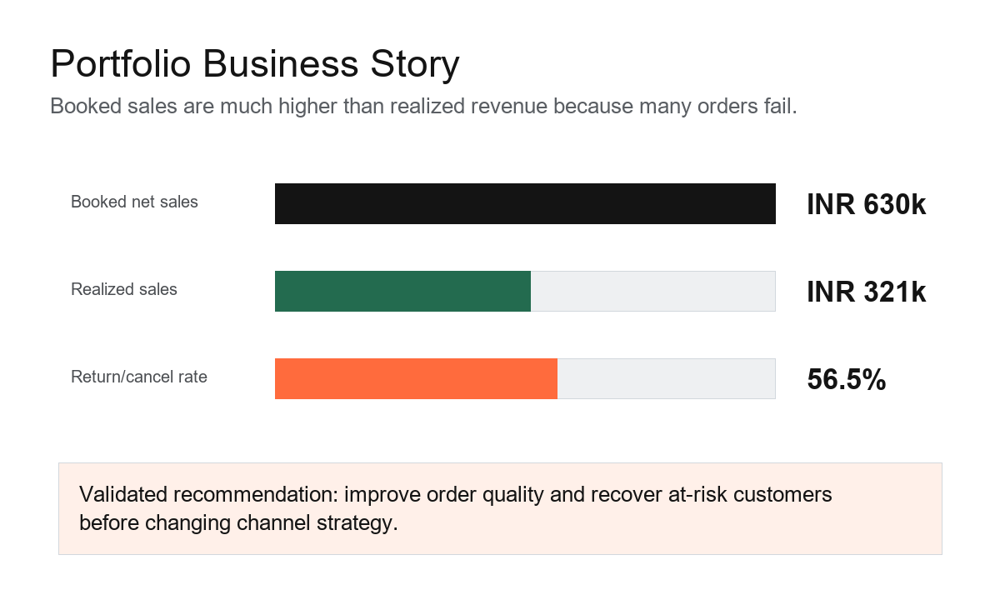

# Sandeep Saini - Data Analyst Internship Portfolio

This repository is the master portfolio for my Data Analytics internship project. It brings together the complete end-to-end analytics workflow from raw data preparation to business intelligence, dashboarding, storytelling, and statistical validation.

## Portfolio Overview

The project follows a business sales dataset through five stages:

1. Data immersion, quality assessment, cleaning, and transformation.
2. Exploratory data analysis and business intelligence reporting.
3. Deep-dive customer segmentation and interactive dashboarding.
4. Data storytelling and statistical validation.
5. Final portfolio integration and professional reflection.

The final business story is that the company should focus on realized revenue recovery. The analysis showed that the main issue was not only order volume, but the gap between booked sales and completed revenue caused by returns and cancellations.

## Key Business Findings

| Metric | Result |
| --- | ---: |
| Orders analyzed | 138 |
| Booked net sales | INR 630,195.86 |
| Realized sales | INR 320,834.34 |
| Delivery rate | 43.5% |
| Return/cancel rate | 56.5% |
| Highest value segment | At-Risk / Recovery |
| Statistical test result | Channel difference was not statistically significant |

## Project Repositories

| Task | Focus Area | Repository |
| --- | --- | --- |
| Task 1 | Data Immersion and Wrangling | https://github.com/sainisandeep0021026-dot/task1-data-wrangling |
| Task 2 | EDA and Business Intelligence | https://github.com/sainisandeep0021026-dot/task2-eda-business-intelligence |
| Task 3 | Deep-Dive Analysis and Interactive Dashboarding | https://github.com/sainisandeep0021026-dot/task3-interactive-dashboard |
| Task 4 | Data Storytelling and Statistical Validation | https://github.com/sainisandeep0021026-dot/task4-data-storytelling-statistical-validation |

## Final Presentation

The refined final presentation deck is included here:

[Download the final presentation deck](assets/Sandeep_Saini_DataAnalyst_Final_Presentation.pptx)

## Technical Skills Demonstrated

- Data cleaning and transformation using Python.
- Data quality assessment and data dictionary creation.
- Exploratory data analysis using summary statistics and grouped metrics.
- SQL-style business question development.
- KPI design for business reporting.
- Customer segmentation and performance comparison.
- Dashboard design and stakeholder-focused reporting.
- Hypothesis testing using a two-proportion z-test.
- Business storytelling and executive presentation design.
- GitHub portfolio organization and documentation.

## Statistical Validation Summary

The final hypothesis test checked whether online and offline sales channels had different delivery success rates.

- Null hypothesis: online and offline delivery rates are equal.
- Alternative hypothesis: online and offline delivery rates are different.
- Test used: two-proportion z-test.
- Online delivery rate: 46.3%.
- Offline delivery rate: 41.7%.
- p-value: 0.592.
- Decision: fail to reject the null hypothesis.

The result means there was no statistically significant evidence that sales channel alone explains delivery success. The stronger business recommendation is to improve order quality, reduce returns and cancellations, and focus recovery actions on high-risk customer segments.

## Learning Reflection

This internship project helped me practice the full analytics lifecycle. I learned how to move from raw data to a clear business recommendation, how to validate insights with statistics, and how to present findings in a way that supports decision-making.

The most important learning was that analysis is not just about creating charts. It is about asking the right question, checking whether the data supports the answer, and turning the result into practical action.

## Optional GitHub Pages Website

This repository includes an `index.html` file that can be used as a simple GitHub Pages portfolio website. After uploading the repository, GitHub Pages can be enabled from repository settings.
